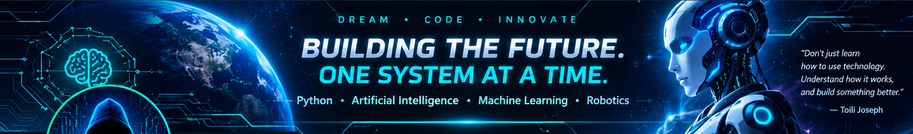

  

# TOILI JOSEPH

### Aspiring AI / ML Engineer | Python Developer | Future Innovator

**Building intelligent systems. Exploring possibilities. Solving real-world problems.**

---

## `> whoami`

I'm Toili Joseph, an aspiring technology innovator with a strong interest in Artificial Intelligence, Machine Learning and Robotics.

I enjoy exploring how technology works, understanding the logic behind systems and developing solutions to real-world problems.

My goal is to move beyond simply using technology to understanding, designing and building it.

## `> current_focus`

- **Python:** Strengthening programming fundamentals and problem-solving.
- **Artificial Intelligence:** Exploring AI and Machine Learning.
- **Robotics:** Developing an understanding of intelligent machines and automation.
- **Innovation:** Exploring technology-driven solutions to practical problems.

## `> technologies`

<h2 align="center">
  <code> &gt; TECHNICAL_TOOLKIT </code>
</h2>

<h3 align="center">PROGRAMMING & DEVELOPMENT</h3>

  
  
  
  

<h3 align="center">AI / MACHINE LEARNING — EXPLORING</h3>

  
  
  
  
  

<h3 align="center">ENGINEERING INTERESTS</h3>

  
  
  

## `> projects_in_progress`

**Farm Records Management System**

A Python-based project focused on organizing farmer information, farm records, land allocation and crop management.

My approach is to build practical systems while strengthening my programming logic and problem-solving skills.

## `> future_vision`

My long-term ambition is to build an AI-driven technology company focused on developing innovative solutions.

I'm particularly interested in the intersection of:

- Artificial Intelligence
- Machine Learning
- Robotics
- Intelligent Automation

## `> philosophy`

> Don't just learn how to use technology. Understand how it works, question its limitations and build something better.

---

### THINK DEEP. BUILD SMART. INNOVATE.

`INITIALIZING THE FUTURE...`

---

## `> github_analytics`

**`THINK DEEP. BUILD SMART. INNOVATE.`**

---

## `> contribution_activity`

---

## `> connect_with_me`

